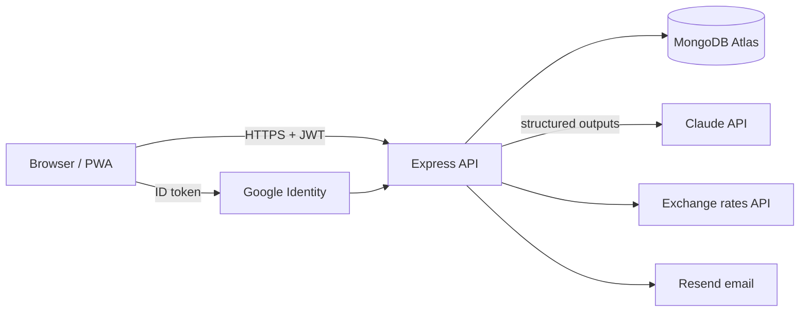

<div align="center">


# Spendly

**A modern, AI-assisted personal finance tracker.**
Track income and expenses in any currency, scan receipts, set budgets and get insights that help you save.

[Live demo](#-deployment) · [Features](#-features) · [Tech stack](#-tech-stack) · [Run locally](#-getting-started)


</div>

---

## ✨ Features

|                               |                                                                                              |
| ----------------------------- | -------------------------------------------------------------------------------------------- |
| 🤖 **AI quick add**           | Type _"lunch 1500 yesterday"_ — Claude turns it into a categorised transaction.              |
| 📸 **Receipt scanning**       | Snap a bill; the merchant, total, date and items are extracted with vision.                  |
| 💡 **AI insights**            | Monthly coaching notes grounded in your numbers (only aggregates are sent, never raw notes). |
| 💸 **Income & expenses**      | Custom categories with icons and colours, notes, search, filters, bulk delete.               |
| 🌍 **Multi-currency**         | LKR, USD, EUR, GBP, INR and more, converted to your base currency with daily rates.          |
| 🎯 **Budgets**                | Monthly and per-category limits that carry over, with near-limit and over-budget warnings.   |
| 🔁 **Recurring transactions** | Rent, subscriptions and salary are recorded automatically on schedule.                       |
| 📊 **Dashboard & reports**    | Cash-flow chart, category breakdown, 12-month trend, PDF statements and CSV export.          |
| 🔐 **Auth**                   | Email + password, Google sign-in, password reset emails, rotating refresh tokens.            |
| 📱 **PWA**                    | Installable, works offline with the last synced data, dark mode, ⌘K command palette.         |

## 🧱 Tech stack

**Frontend** — React 19 · TypeScript · Vite · Tailwind CSS v4 · shadcn/ui (Radix) · TanStack Query · React Router 7 · React Hook Form + Zod · Zustand · Recharts · Motion · vite-plugin-pwa

**Backend** — Node.js · Express 5 · TypeScript · MongoDB + Mongoose · Zod · JWT (access + rotating refresh cookies) · Anthropic SDK · Resend · Google Identity · node-cron · Pino · Helmet · rate limiting

**Quality** — Vitest · Testing Library · Supertest · mongodb-memory-server · ESLint · Prettier · GitHub Actions CI

## 🏗️ Architecture

```
spendly/
├── apps/
│   ├── web/          React SPA (Vite) – deployed to Vercel
│   └── api/          Express REST API – deployed to Render
└── packages/
    └── shared/       Zod schemas, types and money/date/budget helpers used by both
```



- **One source of truth for validation:** the same Zod schemas validate forms in the browser and requests on the server.
- **Auth:** 15-minute access tokens are kept in memory; a rotating, hashed refresh token lives in an `httpOnly` cookie. Reusing an old refresh token is rejected.
- **Money:** every transaction stores its original amount and currency plus a `baseAmount` in the user's base currency, so totals and budgets are always comparable.
- **AI:** Claude is called through structured outputs (Zod schemas), and results are re-validated against the user's own categories before they reach the form.

## 🚀 Getting started

**Prerequisites:** Node.js 20+ and a MongoDB connection string (a free [MongoDB Atlas](https://www.mongodb.com/atlas) cluster works). You can also use `MONGODB_URI=memory` to run against a throwaway in-memory database.

```bash
git clone https://github.com/Pubudugunawardhana/Expense_Tracker.git
cd Expense_Tracker
npm install

cp apps/api/.env.example apps/api/.env   # then fill in MONGODB_URI and JWT_SECRET
npm run seed                             # optional: create the demo account
npm run dev                              # web → http://localhost:5173, api → http://localhost:5000
```

### Environment variables (`apps/api/.env`)

| Variable                       | Required | Description                                                        |
| ------------------------------ | -------- | ------------------------------------------------------------------ |
| `MONGODB_URI`                  | ✅       | MongoDB connection string (`memory` for an in-memory dev database) |
| `JWT_SECRET`                   | ✅       | Long random string used to sign access tokens                      |
| `CLIENT_URL`                   | ✅       | Allowed frontend origin(s), comma-separated                        |
| `ANTHROPIC_API_KEY`            | –        | Enables AI quick add, receipt scanning and insights                |
| `RESEND_API_KEY`, `EMAIL_FROM` | –        | Sends password reset emails (otherwise the link is logged)         |
| `GOOGLE_CLIENT_ID`             | –        | Enables "Continue with Google"                                     |
| `DEMO_ENABLED`                 | –        | Public demo account, reset nightly (default `true`)                |

The frontend only needs `VITE_API_URL` in production (see `apps/web/.env.example`).

### Scripts

| Command                              | What it does                             |
| ------------------------------------ | ---------------------------------------- |
| `npm run dev`                        | Run API and web app together             |
| `npm test`                           | Unit + API integration tests             |
| `npm run lint` / `npm run typecheck` | Static checks                            |
| `npm run build`                      | Production builds of both apps           |
| `npm run seed`                       | Create / reset the demo account          |
| `npm run migrate:v1 -w @spendly/api` | Migrate data from the original v1 schema |

## ☁️ Deployment

1. **API → Render:** create a Blueprint from this repo (`render.yaml`), then set `MONGODB_URI`, `CLIENT_URL` (your Vercel URL) and any optional keys.
2. **Web → Vercel:** import the repo with **Root Directory** `apps/web` and set `VITE_API_URL` to the Render URL.
3. In MongoDB Atlas, allow connections from Render (Network Access).
4. In Google Cloud, add your Vercel URL to the OAuth client's _Authorised JavaScript origins_.

## 🗺️ Roadmap

- Shared household budgets
- Bank statement (CSV/PDF) import
- Savings goals

---

<div align="center">Designed & built by <b>Pubudu Gunawardhana</b> · <a href="https://github.com/Pubudugunawardhana">GitHub</a></div>
